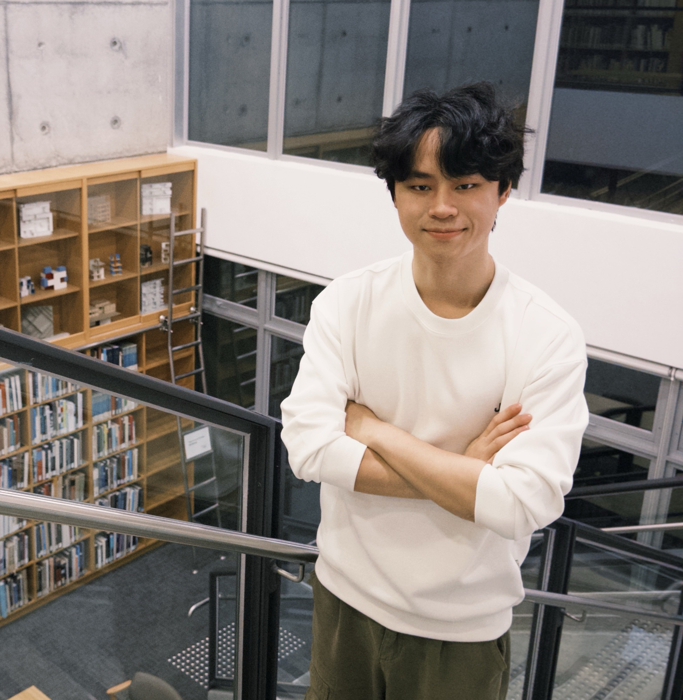
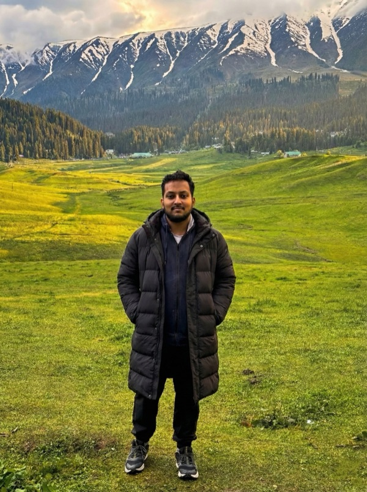
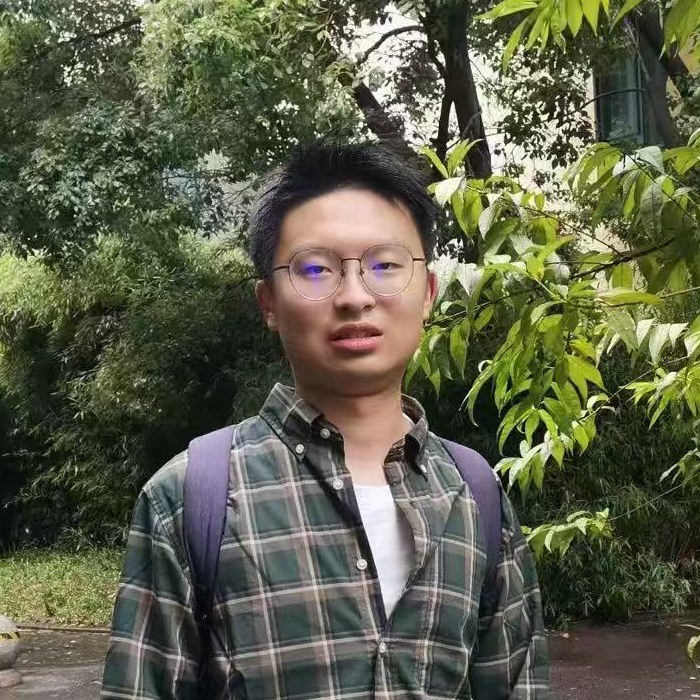
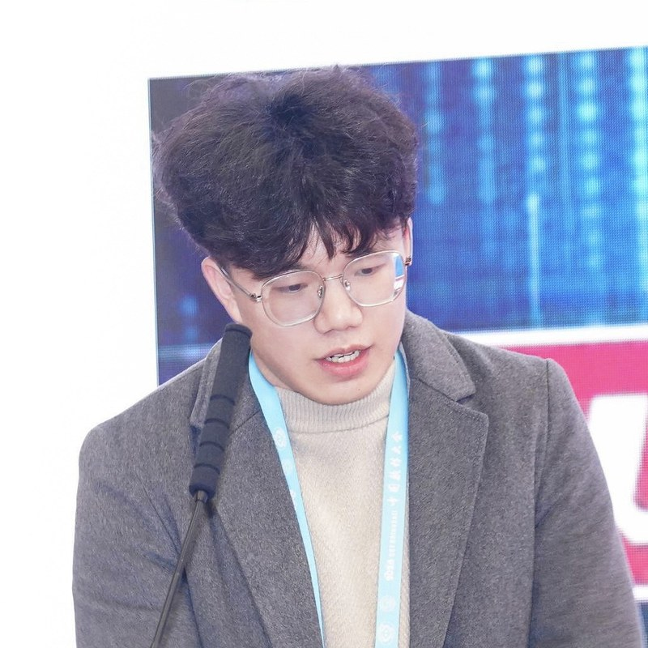

```{=html}
<section id="about" class="intro-section" aria-labelledby="page-title">
      <div class="intro">
        <p class="eyebrow">University of Alberta · Department of Computing Science</p>
        <h1 id="page-title">U-A-Goose</h1>
        <p class="subtitle goose-acronym"><strong>G</strong>r<strong>O</strong>up <strong>O</strong>f <strong>S</strong>oftware <strong>E</strong>ngineering</p>
        <div class="research-text">
          
          <p>We study <strong>trustworthy software engineering in the AI era</strong>, asking: <strong>How can we help AI learn from limited, incomplete experience to reliably build and evolve complex software systems?</strong></p>
          <p>We use software engineering knowledge to shape better learning objectives, experiences, and feedback, helping models explore beyond established solutions and refine their judgments in light of verifiable evidence.</p>
        </div>
      </div>
      <aside class="news" aria-labelledby="news-heading">
        <div class="news-heading"><h2 id="news-heading">News</h2><span>From the group</span></div>
        <div class="news-scroll" tabindex="0" role="region" aria-label="All group news, scroll for older updates"><ol><li><time datetime="2026-11">2026.11</time><div>Yuyang wins the <span aria-hidden="true">🏆</span> <strong>Best Poster Award</strong> from CSER 2026.</div></li>
<li><time datetime="2026-10">2026.10</time><div>Three papers have been accepted to <strong>ICSE 2027</strong>!</div></li>
<li><time datetime="2026-08">2026.08</time><div>Three papers are accepted by <strong>EMNLP 2026 Main Conference</strong>!</div></li>
<li><time datetime="2026-06">2026.06</time><div>Two more papers are accepted by <strong>ISSTA 2026</strong>!</div></li>
<li><time datetime="2026-06">2026.06</time><div>Two papers are accepted by <strong>ASE 2026</strong>!</div></li>
<li><time datetime="2026-05">2026.05</time><div>Dr. Zhou Yang is officially awarded the <strong>Canada CIFAR AI Chair</strong>🏆!</div></li>
<li><time datetime="2026-05">2026.05</time><div>Two papers, PrivCode++ (differentially private code generation) and Watermarking LLM Agent Trajectories, are accepted by <strong>ICML 2026</strong>!</div></li>
<li><time datetime="2026-04">2026.04</time><div>Our paper, Hidden Licensing Risks in the LLMware Ecosystem, is accepted by <strong>ISSTA 2026</strong>!</div></li>
<li><time datetime="2026-04">2026.04</time><div>Our paper, MultiCodeAttack: Iterative Jailbreak Attacking on LLMs with Multi-Code Prompt Injection, is accepted by <strong>ACL 2026</strong>!</div></li>
<li><time datetime="2026-04">2026.04</time><div>My NSERC Discovery Grant has been approved! Grateful for the support to advance our research.</div></li>
<li><time datetime="2026-03">2026.03</time><div>Dr. Zhou Yang's Amii RAP funding (2026 to 2027) 💰 is approved, collaborating with <a href="https://drmatttaylor.net/">Matt Taylor</a>.</div></li>
<li><time datetime="2026-03">2026.03</time><div>One paper on efficient code LLM inference with quantization and compilation-time optimization is accepted by <strong>FSE 2026</strong>.</div></li>
<li><time datetime="2026-03">2026.03</time><div>Hanzheng Dai's doctoral symposium paper on "Automated Diagnosis and Testing of Game Compatibility Layers" is accepted by <strong>FSE 2026 Doctoral Symposium</strong>.</div></li>
<li><time datetime="2026-03">2026.03</time><div>Dr. Zhou Yang wins the <strong>MSR Outstanding Doctoral Research Award</strong>🏆! There is only one awardee this year.</div></li>
<li><time datetime="2026-01">2026.01</time><div>One paper (on automatically protecting critical software operations in TEE) is accepted by <strong>IEEE Transactions on Software Engineering</strong>!</div></li>
<li><time datetime="2025-12">2025.12</time><div>Dr. Zhou Yang wins the <strong>ACM SIGSOFT Outstanding Doctoral Dissertation Award</strong>🏆! There is only one award this year.</div></li>
<li><time datetime="2025-11">2025.11</time><div>Our paper on understanding user perceptions of AI coding assistants wins the <strong>Distinguished Paper Award</strong>🏆 at <strong>ASE 2025</strong>!</div></li>
<li><time datetime="2025-09">2025.09</time><div>Our paper wins the prestigious <strong>2024 IEEE Computer Society Best Paper Award</strong>🏆! (1 out of 183)</div></li>
<li><time datetime="2025-09">2025.09</time><div>Dr. Zhou Yang officially joins the University of Alberta as an Assistant Professor and becomes an <strong>Amii Fellow</strong>.</div></li></ol></div>
      </aside>
    </section>

    <section id="people" class="page-section" aria-labelledby="people-heading">
      <div class="section-heading"><h2 id="people-heading">Our people</h2><a href="#join">Interested in joining? <span aria-hidden="true">↓</span></a></div>
      <article class="pi">
        
        <div class="pi-identity"><p class="eyebrow">Principal Investigator</p><h3>Prof. Zhou Yang</h3><p>Assistant Professor<br>University of Alberta<br>Canada CIFAR AI Chair<br>Amii Fellow</p><p class="person-links"><a href="https://homepage.zhouyang.me/">Homepage</a><a href="mailto:zy25@ualberta.ca">Email</a><a href="https://scholar.google.com/citations?user=4oWBhPsAAAAJ&amp;hl=en">Scholar</a></p></div>
        <div class="pi-bio"><p>Zhou Yang is an Assistant Professor in the Department of Computing Science at the University of Alberta, a Canada CIFAR AI Chair, and an Amii Fellow. He completed his Ph.D. at Singapore Management University in early 2025, after earning an MSc from University College London. He previously served as a senior research engineer at the Centre for Research on Intelligent Software Engineering.</p>
<p>His research establishes scientific and practical foundations for trustworthy code LLMs, integrating robustness, security, privacy, ecosystem understanding, and efficiency to support safer AI adoption in software engineering. He has received multiple major awards, including the 2026 MSR Outstanding Doctoral Research Award, the 2025 ACM SIGSOFT Outstanding Doctoral Dissertation Award, and the 2024 IEEE Computer Society Best Paper Award.</p></div>
      </article>
      <div class="graduate-groups">
        <section class="people-group" aria-labelledby="phd-heading"><h3 id="phd-heading">PhD students</h3><div class="people-grid two"><article class="person">
          
          <div><h4>Hanzheng (Hozier) Dai</h4><p class="person-role">PhD Student, CS Department</p><p class="person-detail">Joined Jan 2026</p>
          <p class="person-links"><a href="mailto:hanzhen3@ualberta.ca">Email</a>
          <a href="https://hozierddd.github.io/">Homepage</a></p></div>
        </article>
<article class="person">
          
          <div><h4>Ming Melvin Wang</h4><p class="person-role">PhD Student, CS Department</p><p class="person-detail">Joined Sep 2026</p>
          <p class="person-links"><a href="https://melvin-king.github.io/">Homepage</a></p></div>
        </article>
<article class="person">
          
          <div><h4>Zhihan Yang</h4><p class="person-role">PhD Student, CS Department</p><p class="person-detail">Joining in Dec 2026</p></div>
        </article></div></section>
        <section class="people-group" aria-labelledby="msc-heading"><h3 id="msc-heading">MSc students</h3><div class="people-grid two"><article class="person">
          
          <div><h4>Tanzim Hossain Romel</h4><p class="person-role">MSc Student, CS Department</p><p class="person-detail">Joined Sep 2026</p>
          <p class="person-links"><a href="https://tanzimhromel.com">Homepage</a></p></div>
        </article>
<article class="person">
          
          <div><h4>Zipeng Ling</h4><p class="person-role">MSc Student, CS Department</p><p class="person-detail">Joined Sep 2026</p>
          <p class="person-links"><a href="mailto:zipeng6@ualberta.ca">Email</a>
          <a href="https://zpling.github.io/">Homepage</a></p></div>
        </article></div></section>
      </div>
      <section class="people-group" aria-labelledby="visitors-heading"><h3 id="visitors-heading">Visitors &amp; research assistants</h3><div class="people-grid four"><article class="person">
          
          <div><h4>Zixi Chai</h4><p class="person-role">MEng Student, ECE Department</p><p class="person-detail">Joined Jan 2026</p>
          <p class="person-links"><a href="mailto:zchai3@ualberta.ca">Email</a></p></div>
        </article>
<article class="person">
          
          <div><h4>Yuyang Wang</h4><p class="person-role">Undergrad Student, CS Department</p><p class="person-detail">Joined May 2026</p>
          <p class="person-links"><a href="mailto:yuyang31@ualberta.ca">Email</a></p></div>
        </article>
<article class="person">
          
          <div><h4>Boyuan Sun</h4><p class="person-role">Undergrad Student, CS Department</p><p class="person-detail">Joined Jan 2026</p>
          <p class="person-links"><a href="mailto:bsun5@ualberta.ca">Email</a></p></div>
        </article>
<article class="person">
          
          <div><h4>Xingan Gao</h4><p class="person-role">PhD Student, Yangzhou University;<br>CSC Visiting PhD, UAlberta</p><p class="person-detail">Joined Sep 2026</p>
          <p class="person-links"><a href="mailto:DX120250116@stu.yzu.edu.cn">Email</a></p></div>
        </article></div></section>
      <section class="people-group honor-group" aria-labelledby="honor-heading"><h3 id="honor-heading">Hall of Honor <span>IRCC Delayed Students</span></h3><div class="people-grid three"><article class="person">
          
          <div><h4>Geng He</h4><p class="person-role">Incoming PhD Student at HKUST(GZ)</p><p class="person-detail">Co-Advised with <a href="https://v587su.github.io/">Dr. Zhensu Sun</a></p>
          </div>
        </article>
<article class="person">
          
          <div><h4>Jingfeng Jiang</h4><p class="person-role">Now PhD Student@Korea University</p><p class="person-detail">Co-Advised with <a href="https://www.darkrsw.net/">Prof. Dongsun Kim</a></p>
          </div>
        </article>
<article class="person">
          
          <div><h4>Wenjia Jiang</h4><p class="person-role">Now Intern at Microsoft</p><p class="person-detail">Co-Advised with <a href="https://cumt-gpf.github.io/">Dr. Pengfei Gao</a> and <a href="https://lindayi.me/">Dr. Dayi Lin</a></p>
          <p class="person-links"><a href="https://jwj1342.github.io/">Homepage</a></p></div>
        </article></div></section>
    </section>

    <section id="join" class="page-section" aria-labelledby="join-heading">
      <div class="section-heading"><h2 id="join-heading">Join the group</h2><a href="mailto:zy25@ualberta.ca">zy25@ualberta.ca <span aria-hidden="true">↗</span></a></div>
      <p class="section-intro">We welcome self-motivated students interested in software engineering, trustworthy AI, and code LLM research.</p>
      <div class="openings-grid">
        <article><p class="eyebrow">Graduate study</p><h3>PhD / Master by Research</h3><p>Applications for <strong>Fall 2027 are now open</strong>, but <strong>only very limited positions are available</strong>.</p><p>Contact <a href="mailto:zy25@ualberta.ca">zy25@ualberta.ca</a> with your CV, transcript, and a brief description of your research interests.</p></article>
        <article><p class="eyebrow">Research experience</p><h3>Research assistants</h3><p>For current University of Alberta students, including ECE Master's students and undergraduates, interested in joining the group as research assistants.</p><p>Send your CV and transcript to <a href="mailto:zy25@ualberta.ca">zy25@ualberta.ca</a>.</p></article>
        <article><p class="eyebrow">Individual studies</p><h3>CMPUT 399 / CMPUT 499</h3><p>For University of Alberta undergraduates interested in taking an individual study course with the group.</p><p>Contact <a href="mailto:zy25@ualberta.ca">zy25@ualberta.ca</a> with your CV and transcript.</p></article>
      </div>
      <div class="screening">
        <div><h3>Getting started</h3><p>All prospective research assistants and individual study students go through a lightweight screening process, which typically involves:</p></div>
        <ol><li><span>01</span><div><h4>Read</h4><p>A few selected papers relevant to your intended research area.</p></div></li><li><span>02</span><div><h4>Present</h4><p>A short talk to demonstrate your understanding of the papers.</p></div></li><li><span>03</span><div><h4>Implement</h4><p>Reproduce or implement baseline methods.</p></div></li></ol>
        <p class="screening-note">We consider academic merits, prior research experience, and alignment with the group's research directions to assess research potential and ensure a good mutual fit.</p>
      </div>
    </section>

    <section id="community" class="page-section community-section" aria-labelledby="community-heading">
      <div class="section-heading"><h2 id="community-heading">In the community</h2><span class="muted">2026 events</span></div>
      <p class="section-intro">We help build research communities around software engineering, human-centered AI, and trustworthy code LLMs.</p>
      <div class="events">
        <article><div class="event-place">Edmonton <span>May 23–24, 2026</span></div><div><h3><a href="https://www.cser.ca/2026s/">CSER 2026 <span aria-hidden="true">↗</span></a></h3><p>University of Alberta · Spring meeting</p></div></article>
        <article><div class="event-place">Montreal <span>FSE 2026</span></div><div><h3><a href="https://humanai4se.github.io/">HumanAISE 2026 <span aria-hidden="true">↗</span></a></h3><p>2nd Workshop on Human-Centered AI for Software Engineering</p></div></article>
        <article><div class="event-place">Montreal <span>July 6, 2026</span></div><div><h3><a href="https://poisonedchalice.github.io/">Poisoned Chalice Competition 2026 <span aria-hidden="true">↗</span></a></h3><p>Co-located with FSE 2026</p></div></article>
      </div>
    </section>

    <section class="support" aria-labelledby="support-heading"><h2 id="support-heading">Funding &amp;<br>institutional support</h2><div class="support-logos"><a href="https://www.amii.ca/"></a><a href="https://cifar.ca/"></a><a href="https://www.ualberta.ca/en/index.html"></a><a href="https://nserc-crsng.canada.ca/en"></a></div></section>
```
